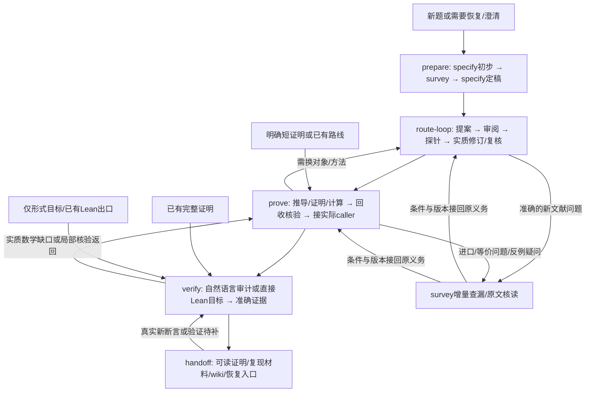

# MathRSI：从问题准备到可检查证明的工作流

两张[架构图](../figures/mathrsi/README.md)概括了内外两层：本页执行五组解题子流程；经验反馈由独立外层技能 [mathrsi-meta-evolve](../base/skills/mathrsi-meta-evolve/SKILL.md) 执行，人读说明见[版本演进入口](EVOLUTION_WORKFLOW.md)，不把维护混成第六个解题阶段。

[数学研究总控](../base/skills/mathrsi-research/SKILL.md)负责选择当前入口、调用子流程、读取产物并决定下一行动。它不把整项工作变成阶段名称的清单，也不替代理规定唯一证明技术。八项数学子技能与总控组成五组有独立交付的解题流程；内部复用本仓完整ARIS、当前领域方法及已有程序，不创建新的调度平台。

新题通常从准备开始。已有明确路线可以直接prove；已有完整证明直接verify；仅形式目标直接走verify的Lean入口，不要求先写TeX；只需交接已有研究则直接handoff。原规格、wiki、证据和文件名都沿用任务工作区，技能源码留在MathRSI。每组完成后由唯一上层调度者读取产物，在同一轮内继续已授权工作；用户只要求其中一阶段时才在该交付点结束。

**阶段调度只由一个调用者拥有。** 由mathrsi-research调用时，它是唯一上层调度者；被调用的prepare、route-loop、prove、verify或handoff只完成本次scope，返回产物、未闭义务及next，不自行启动同级下一stage。内部局部调用仍可执行：prepare调用specify／survey，verify调用assemble／proof-checker，route-loop／prove调用定点survey或局部verify；这些调用完成后回原调用点。用户直接调用某个子流程且明确授权接续时，当前代理承担唯一调度职责，切入下一阶段一次，不能同时让另一个父调度者再启动一遍。

以下转移有[两个项目的六条历史实证](../development/workflow-redesign/REAL_PROJECT_TRANSITIONS.md)作具体依据：Property B的24点局部caller闭合后回剩余23点，而非提前交付；ECC补独立全域集合后回pair caller，无边必要条件足够时停止更贵扩张。数学细节与当时未闭范围见该记录，原ECC交接的仓内只读快照见[来源说明](../development/context/ecc-source/README.md)。这是历史经验的流程提炼；本轮没有重新求解这两题、重放全部计算或验证新流程提速。

六个领域的逐阶段调用维护在[DOMAIN_ROUTING](DOMAIN_ROUTING.md)，并由每个实际SKILL的领域调用处读取执行。它给定ECC、极值超立方体、Hamilton超立方体和Happy Ending的真实输入、产物消费与回流；v3保留本页五阶段结构，见[V3_CHANGES](V3_CHANGES.md)。v4在同一route-loop/prove/verify中加入[临界取等与相容见证](../base/skills/mathrsi-prove/references/critical-equality.md)，并原位深化Happy Ending与DD；具体范围见[V4_CHANGES](V4_CHANGES.md)，固定版本为`v4`。

`main` 的 v4 后续维护把[全局重评](../base/skills/mathrsi-research/references/global-reassessment.md)接入五阶段：每批派工／收件回看原题瓶颈，触发时由默认两位独立只读代理分别核原题连接／路线与总成本，必要分歧加第三位；原父调用者消费后调度下一动作一次。固定 `v4` 标签不包含此次维护且不移动，仍为10项base技能、五阶段、六领域和14项领域技能。

## v5：控制接口、消费已证工具、覆盖全部输入

v5 在现有 route/prove/verify 中落实三项动作。先区分任意原输入、能合法选择的辅助量和选择后才产生的实际后继；优先构造足够的后继接口，避免无依据地放大成任意辅助对象。新定理返回后，先对同一输入的已知合法切分、可回推运输和单调补全消费它，再给所有门均失败的真正余域派工。

有限计划可以是“每个几何先固定一个计划，覆盖该几何的每个实现”，也可以是“先给有限计划集，每个实际输入至少有一个分支可用”；verify 核完整分支覆盖、适用前提及展开后保留原边。已有 v4 全局重评照常执行。具体变化见 [V5_CHANGES](V5_CHANGES.md)，来源与数学边界见 [Q7 案例](../case-studies/ruskey-savage-q7/README.md)。五阶段与六领域不变。

## v6：难余域准入、上下界协同循环与修补残差停机

v6 在现有五阶段结构中新增三项共性纪律（详见 [V6_CHANGES](V6_CHANGES.md)）：
1. **难余域优先把关：** 提出新分类切分前先在最难未闭分支做有界探针，按同一原输入相对已有定理并集度量净新增覆盖；简单旁支通过不重置难核停滞计数（[实际输入覆盖](../base/skills/mathrsi-prove/references/actual-input-coverage.md)）。
2. **上下界协同进化：** 对接 [primal-dual-coevolution](../base/skills/mathrsi-route-loop/references/primal-dual-coevolution.md)，分离开放的主证明目标与对抗反例目标，用四通道有符号归一化残差轮换引导下界程序搜索，并在**全部已归档图**上反驳候选不等式后再导出 `empirical` 义务进入 `prove`。
3. **修补残差阈值停机：** 当浮点 SDP/CP/LP 外层迭代增益低于修补残差阈值时立即停机，并在任何未认证近似拟合旁并列记录非零可行性残差，不将其写成已证屏障。

`main` 的 v6 后续维护在原 route/prove/verify 中补入[终端域比较](../base/skills/mathrsi-prove/references/actual-input-coverage.md#密层结论返回后先比较保留原要求的终端域)：收回密层/终端定理后，先证明从任意原输入保留原要求的有限补全，将终端界与准确已证域衔接，只派尚未覆盖的终端域；结构排空也能关闭该责任。用于结构反证的删改/翻转不自动运输目标见证，固定规模结论也不通过删原标记升级为阈值结论。它深化已有工具消费，不增加阶段或移动固定 `v6` 标签。

## v7 正式版

在已有 route、prove、verify 中，两类结论会改变下一步派工。对可以保留原要求逐步补全的问题，把全部终止对象与已有接收定理逐一对上，处理两者之间的缺口。对多个局部容量已很紧的问题，尝试在同一对象上保留每类的全部合法见证，把多出的选择折算进同一份整数预算，再定位仍可能发生的损失。[版本说明与两个案例](V7_CHANGES.md)

## 五组流程与实际回流



阶段间箭头表示返回产物后由上层调度的转移，不是child自行启动同级阶段；survey与局部verify的往返箭头表示当前scope内的调用与返回。不要求每次都走图上每一边。纯符号、索引、代码或Lean API错误通常在当前步骤修；关键引理被反驳、核心表示失效或全局重评决定转路线时，由调度者回路线。局部verify由prove调用，就返回同一prove义务，不因局部PASS启动全题handoff。wiki贯穿各阶段，图中未画成单独终点。

## 子流程一：准备问题并查清可用知识

[mathrsi-prepare](../base/skills/mathrsi-prepare/SKILL.md)组织三个连续动作。先由 [mathrsi-specify](../base/skills/mathrsi-specify/SKILL.md)初步模式读取用户原题和已有状态，区分原对象、量词、参数、允许终点与会影响解题的歧义。初步问题足以搜索即可进入调查，不能在查文献前默认题目全新或只适合某种方法。

随后 [mathrsi-survey](../base/skills/mathrsi-survey/SKILL.md)把本地PDF和wiki作为种子，真正调用research-lit及可用的外部来源，查异名、等价表述、前后引用、反例和勘误。发现阅读可先看前三页；关键数学进口继续读完整声明、证明及必要前置，记版本、条件、原文位置与本题映射。ingest创建骨架后，wiki-enrich补基础内容，重要数学条件仍从原文核对，不把骨架填满当作数学已审。

specify初步模式只交回规格与调查委托，由prepare执行一次survey；不是specify先调查、prepare再重查。启用领域插件时共享一次research-lit和唯一LITERATURE writer：Property B实际接[propertyb-literature](../plugins/propertyb/skills/propertyb-literature/SKILL.md)的查询、archive种子、误读及来源核对；Degree–diameter实际接[mathrsi-degree-diameter](../plugins/degree-diameter/skills/mathrsi-degree-diameter/SKILL.md)和[dd-transfer-diagnosis](../plugins/degree-diameter/skills/dd-transfer-diagnosis/SKILL.md)§4，将原wiki与公开比较目录作本地种子，核目标(d,D)的发表实例、已知族合法代入及正则/最大度条件，返回原进口与受影响队列。领域独占提取稿作为附件或返回正文合入，不各跑一轮发现；ECC与三个新增领域的定义、来源和返回按[领域调用](DOMAIN_ROUTING.md)对应准备分支执行。

specify定稿再消费调查，固定精确原题、允许进口和验收边界。文献已有直接证明就组织其准确推论；发现反例就先核是不是原命题反例。查新不强不能成为agent自行改题的理由。用户固定的任务可能是复现、独立证明或指定目标，不由新颖性分数取消。

新任务默认得到 `FORMAL_SPEC.md`、`LITERATURE.md`及更新的 `NEXT_SESSION.md`，实际资料与持久知识留在原资料目录和wiki。父流程读取正式量词、可用进口和仍缺来源后，交给路线设计或清楚的证明推进；不是仅看见三个文件就宣布准备通过。

可复制任务：

```text
读取 /实际路径/MathRSI/base/skills/mathrsi-prepare/SKILL.md并执行。
任务目录 /我的任务目录，原题见 ref/problem.pdf 和用户给定要求。
先恢复已有规格/wiki/状态；新题先形成足以检索的初步问题，
再实际调查本地种子和外部异名/引用/勘误/反例，核关键进口，
最后定稿FORMAL_SPEC并交回LITERATURE的可用结论与准确缺口。
原目标不变；返回准备产物及next给主流程，不自行启动route-loop或prove。
```

已有充分调查时只补变化或遗漏链。某篇关键原文仍取不到，可继续不依赖它的推导，保留待核进口，不把外网失败记成“没有相关文献”。

## 子流程二：把方法变成有证据支持的可行动路线

[mathrsi-route-loop](../base/skills/mathrsi-route-loop/SKILL.md)消费正式规格、调查、插件和旧失败，先确定本轮要改变什么决定。主路线要说明任意原输入怎样到工作对象、关键新命题是什么、假定它成立后如何回目标。候选、已证和文献进口分开，不能把“可以选到”或“可以同时规范化”提前当作事实。

它是 ARIS auto-review-loop 的数学适配，实际执行完整的改进回路：恢复已有路线与审阅记忆 → 跨模型审阅和证据回应 → 实施推导、证明或计算修法 → 收回并核对实际结果 → 带变更续接复核 → 保存本轮判断与断点。每位 reviewer 的持续关切与原始回应独立保留，终轮也更新；中断在修法阶段就从修法恢复，不能每次重新索要一份初审。

审阅阶段按 `research-review` 的完整数学适配执行资料收集、初审、必要对话、证据与条件结论对照、交接和 trace，显式用 `— composed: <ROUTE_REPORT的绝对路径>` 合入唯一累计报告。route-loop拥有外层轮次和修法调度，research-review的每次对话返回这一调用点。原版的训练与投稿分数门替换为可执行数学路线的判断，其余记忆、实作、复核和恢复不会因此省掉。Python路由解析、MCP桥接与agent的具体调用见[跨模型调用说明](REVIEWER_MCP.md)。模型意见可被真实数学证据驳回，双方判断分别保留；路线可行动不代表原定理成立。

默认 `ROUTE_REPORT.md`记录方法、未证条件、实际审阅和探针、选线依据、首批任务、停止／重启条件。主流程读它后，应能立刻把某条精确引理或真实计算交给prove。若只有“多研究某方向”，该交付仍不足；若关键引理已有反例，则停止依赖它的任务并保留见证。

可复制任务：

```text
读取 /实际路径/MathRSI/base/skills/mathrsi-route-loop/SKILL.md并执行。
输入FORMAL_SPEC、LITERATURE、现有失败和任务预算。
这次要决定：当前松弛失败是缺共同条件，还是核心方法本身无增益？
提出可检查方法，实际审阅并做最低区分性推导/探针，
将结果及必要修订写入ROUTE_REPORT，交出prove首批可执行任务。
新增文献疑问交survey定点查清后回原义务，不从头重做全部准备。
完成当前scope后返回产物及next，由主流程调度prove，不自行再启动一遍。
```

局部轮次用尽是交接点，不自动暂停Goal。主流程可按实际结果继续prove、定向survey或另一条已支持路线；资源和用户授权边界仍按原任务执行。

## 子流程三：实际推进证明、构造与计算

[mathrsi-prove](../base/skills/mathrsi-prove/SKILL.md)读取路线的实际任务后开始求解。对象或公式链尚不稳时调用formula-derivation；命题已明确时调用proof-writer；领域方法和程序用对应插件。它们分别返回推导包、完整论证／反例／准确缺口或实际计算结果，由协调者读取并接到同一个原对象的caller。写过一条条件定理尚不等于已从任意原输入满足其条件。

### 反复使用的ARIS技能怎样接棒

这组技能来自已解Property B与ECC的实际工作。表中每行是一项真实调用和消费动作；按当前缺口选择，不要求每道题全部走一遍。相应宿主完整入口、helper及MCP参数见[ARIS_REUSE](ARIS_REUSE.md)和[REVIEWER_MCP](REVIEWER_MCP.md)。

| 当前要解决的事情 | 实际调用及给出的输入 | 调用者读回后做什么 |
|---|---|---|
| 原对象、核心量或公式链还不稳定 | formula-derivation：原规格、已证条件、散式、待达到的界 | 读每个等号/不等号的依据及未证条件；选出真正影响目标的准确引理，再交proof-writer，不把排好公式当证毕 |
| 一项缺失引理或原题连接已明确 | proof-writer：完整量词、允许进口、上游输入、下游用途 | 读实际证明/反例；条件成立就代入caller，条件仍缺就保留该义务；需要关键质疑时送research-review |
| 新题查漏或新障碍涉及未知文献 | research-lit：初步规格/具体疑问、异名、已有查询和PDF | survey核原文条件后交回定稿或原证明义务；不能用论文目录替代可调用定理 |
| 有新引理、失败、反例、实验或进口需要复用 | research-wiki；paper页缺数学内容时再wiki-enrich | 指定唯一wiki写者，更新真实实体和带依据的关系，读回重要条件，恢复页直接链接；下轮实际读取这些结果 |
| 新路线/归约存在具体争议 | research-review数学适配：原题、原件、caller、旧关切、新证据及显式composed报告 | 完成必要证据对话，回交关切、原回应与最低补证；由route/prove/verify实施修法并决定复核，不按原Step4推进到论文共识 |
| 完整证明或自足局部定理需要正式审计 | proof-checker：声明的源集合、规格、进口、代码证据与范围 | verify消费它实际执行的审计/反例/修复结果；局部结果回原义务，完整结果才支持最终交接；实质新数学回prove |
| 用户要求形式化，或真实接口值得内核核验 | lean-formalize：同一原题、固定工程、证明及待接调用 | 核实际目标模块、顶层声明、原题复述和公理依赖；数学缺口回prove，API/编译问题在Lean内解决 |
| 正文和状态已确定，需要给人看与复现 | render-html：完整规范正文、真实证据及用户阅读需求 | handoff实际打开页面核公式和状态，核心证明收入正文；再按需求打包源码/证书/命令并从解压目录核导航 |

例如“关键进口不适用”会触发research-lit回流；“引理成立但原对象未满足前提”继续调用proof-writer补caller；“原文说解了而实际计数不严格”先查程序/算术和表示。它们不是统一再跑一次auto-review-loop的理由。研究得到的新事实及时进原wiki，之后的调用要把它作为输入，而非仅在最终交接提一次wiki。

可独立交付的引理、实现、来源核查与分块复算可以交worker，写域独占，完整产物到达立即回收。Root处理关键共同连接，不等一批worker都结束才发现接口不同。已证引理、闭合父分支与可靠见证及时消费，停止被覆盖的替代工作；不为凑并发或扩表继续制造无用局部产物。

常用草稿为 `PROOF_DRAFT.md`，复杂义务可用 `OBLIGATIONS.md`，但已有正文或短证明的一份文件就够。计算有真实输入、谓词、范围和结果；样本成功、松弛坏型和原题反例分别解释。域完整排除不能由未搜到替代，存在性见证也不必先穷尽所有发现过程。

可复制任务：

```text
读取 /实际路径/MathRSI/base/skills/mathrsi-prove/SKILL.md并执行。
沿ROUTE_REPORT中的已选路线，先处理当前共同选取引理及其caller。
允许进口见LITERATURE，已有严格部分见PROOF_DRAFT。
直接推导并按需要委派独占任务，完整产物立即核读和代入。
新进口疑问交survey补查并回同一义务；关键方法失效或全局重评决定转路线时返回route-loop。
形成完整候选后返回实际正文、证据及verify这一next，由主流程启动验证。
局部survey/verify调用仍在当前义务内完成并返回，不启动全题下一阶段。
```

算术／符号／索引、代码错误、明确子引理和稳定覆盖剩余域的计算，继续在prove内处理。严格反例击穿关键依赖、原输入无法满足新条件、联合规范化冲突或证明松弛无收益时，返回具体失败与重选路线的next，由上层调度route-loop。新术语、遗漏来源或反例出处可在route-loop、prove任一scope内调用survey；只收回原文结果并回同一义务，不调用specify或替换用户目标。

## 子流程四：装配与验证完整候选，或提前核一个关键局部义务

[mathrsi-verify](../base/skills/mathrsi-verify/SKILL.md)先区分本次是全题还是局部。自然语言候选散落时内部调用 [mathrsi-assemble](../base/skills/mathrsi-assemble/SKILL.md)，由它用proof-writer组织原题、严格引理、进口和证据，形成 `PROOF.md`或沿用现有TeX。已有完整且准确的稿件直接复用，不为触发writer重写。

验证针对实际疑问选择覆盖论证、独立精确复算、局部审阅、完整proof-checker和按需Lean。ARIS proof-checker拥有自己的义务审计、反例检查、修复与复审；verify实际运行该流程并消费其真实 `PROOF_AUDIT`，不取一段prompt后自造canonical audit。Markdown适配为TeX时保留原句和输入对应；detector没看到theorem而返回N/A不等于证明已审。

**仅形式目标可以直接进入lean-formalize。** 用户只核固定Lean见证或已有导出时，不先制造TeX、writer或proof-checker审计；给真实模块、原声明、定义与已有证据，消费actual export/build/传递公理后返回原caller。需要自然语言正式审计时仍执行原checker合同，两项各自报告。实例见[固定F4出口](../base/skills/mathrsi-verify/references/lean-target-entry.md)。

Lean由用户要求、现有工程或具体义务收益决定。复用有效构建，核真实主模块、原命题类型、传递公理与实际输入连接；`Certificate x → Target x`还需供给证书。API问题留形式化内部，新的数学缺口回prove。无数值表的纯证明不制造算术检查，无形式化要求的短证明不强制Lean。

`VERIFICATION.md`链接各项真实结果，说明其准确scope和原题状态。局部PASS返回其prove caller；全局所需数学和约定核验成立，返回handoff这一next，由上层调度进入交付。FAIL是这份证明有问题，不自动表明原题为假；ERROR或BLOCKED是未审完／缺材料，不是数学反例。

已有完整证明可复制：

```text
读取 /实际路径/MathRSI/base/skills/mathrsi-verify/SKILL.md并执行。
原题FORMAL_SPEC，现有完整稿PROOF.md，证据见所附原目录。
复用现稿；需要时做无损审计输入适配，实际运行对应宿主proof-checker，
核本题适用的覆盖/独立准确计算，按用户要求接现有Lean工程。
真实结果写VERIFICATION；返回实际产物、缺口和next给本次调用者。
全题缺口建议prove，全部成立建议handoff，由上层调度同级阶段。
```

只核局部时将范围改成：“只核引理L的自足证明、caller C和参数域D；返回原prove继续其下游，不审其余章节、不启动最终交付。”

## 子流程五：交出读者可用的结果和接手者可恢复的断点

[mathrsi-handoff](../base/skills/mathrsi-handoff/SKILL.md)消费实际正文与验证，整理完整可读证明、复现材料和入口。用户需要HTML、PDF或ZIP时才调用相应ARIS技能和工具，并检查实际显示／解压读取；展示保真与数学正确性分别记录。`render-html --offline`只去CDN、保留raw math，不能凭flag名宣称已具备离线SVG公式。

有计算时给真实输入、覆盖、checker及执行命令；有Lean时给固定toolchain／manifest和真实主声明审计。独立目录重放保存实际cwd、退出码和结果；同一代理在第二目录复算不称另一人复现。包中没带的工具链或大数据说明获取依赖，不把作者另一工作区当隐藏前提。

默认 `HANDOFF.md`链接正文、`VERIFICATION.md`和复现入口，`NEXT_SESSION.md`写当前严格结论、准确剩余义务、在途任务与下一动作。wiki沿原schema记录真实结果，proof-axis状态跟随实际audit，不因ZIP生成自动升级。未完成的研究也能交接，交接完成与原题完成分别写。

可复制任务：

```text
读取 /实际路径/MathRSI/base/skills/mathrsi-handoff/SKILL.md并执行。
原题FORMAL_SPEC、正文PROOF、真实验证VERIFICATION。
按本次要求准备可读证明和复现材料；需要的HTML/包实际检查，
更新原wiki和NEXT_SESSION，准确区分已证、待核与尚缺数学。
发现新数学或验证待补，返回准确缺口及prove/verify这一next，
由上层调度相应阶段，保留已有有效结果。
```

## Degree–diameter通过现有五流程接入

DD的四个技能不组成第二套主workflow。[mathrsi-degree-diameter](../plugins/degree-diameter/skills/mathrsi-degree-diameter/SKILL.md)先核有限简单无向图、最大度/直径/阶数及本次终点，再按以下实际接口返回父阶段。

| 父阶段 | 领域调用与输入 | 返回后的实际消费 |
|---|---|---|
| prepare/survey | 总入口＋[dd-transfer-diagnosis](../plugins/degree-diameter/skills/dd-transfer-diagnosis/SKILL.md)：原规格、公开来源、已查基线 | 固定对象/进口；竞争目标更新候选队列，固定构造题保持原目标；共享一次文献调查 |
| route-loop | transfer＋[dd-construction](../plugins/degree-diameter/skills/dd-construction/SKILL.md)：实际失败输入与共同对象 | 采用改变障碍的新规则及首项探针，不把旧充分条件失败写成全域不可能 |
| prove | construction或[dd-obstruction-certificate](../plugins/degree-diameter/skills/dd-obstruction-certificate/SKILL.md)：真实source、参数、允许操作 | 接图定义、degree、全部点对覆盖caller或准确条件/缺口 |
| verify | [dd-obstruction-certificate](../plugins/degree-diameter/skills/dd-obstruction-certificate/SKILL.md)：正文、实际图/model/证书及有限域 | 核精确有限命题；§4–5也核正构造的字面属性、覆盖、证据继承与固定Lean出口；局部回原prove，不另开最终verify |
| handoff | 已有领域证明、运行/审阅范围与复现入口 | base按所需交付取材料；源wiki只读，新任务wiki留当前工作区 |

[DD资料层](../plugins/degree-diameter/README.md)随仓保留原wiki和支撑原件；新构造/排除条件先读完整证明及caller。上表是当前实现接口，历史DD不是MathRSI v1/v2的新解题实验；本轮具体使用见[v2说明](V2_CHANGES.md)。

## 连续使用与宿主调用

主流程会按现有产物串接，子流程返回时不自行启动下一stage；下面是用户希望手动逐阶段操作时的序列，不能与另一个正在运行的主调度重复发起。斜线只用于已正确发现本仓技能的Claude；Codex使用美元调用或先读实际路径。不支持的新flag不靠示例文字“创造”出来，各技能接受自然语言说明当前输入与任务。

```text
Claude（已发现本仓技能，按需逐项调用）：
/mathrsi-prepare  在当前任务恢复或准备原题，定稿后回交实际文献依据。
/mathrsi-route-loop  消费刚才的规格和调查，实际迭代可行动路线。
/mathrsi-prove  沿所选路线求解，返回完整候选及验证next。
/mathrsi-verify  装配并执行适用核验，局部缺口返回其caller。
/mathrsi-handoff  整理已核结果、复现与恢复材料。

Codex（已发现本仓技能，分别发出对应请求）：
$mathrsi-prepare  在当前任务恢复或准备原题。
$mathrsi-route-loop  消费上一步实际规格与调查，迭代路线。
$mathrsi-prove  沿所选路线实际求解。
$mathrsi-verify  核已有完整候选或指定局部义务。
$mathrsi-handoff  整理实际结论与交接。
```

尚未发现技能时，直接“读取 `/实际路径/MathRSI/base/skills/相应技能/SKILL.md`并执行”即可。内部ARIS的Codex入口是 `base/skills/skills-codex/名称/`，Claude入口是 `base/skills/名称/`；helper显式绑定同一克隆的 `base/tools`，详细说明见 [ARIS_REUSE](ARIS_REUSE.md)。

## 产物归属、停止与恢复

阶段默认产物的参考见 [WORKSPACE](WORKSPACE.md)，原项目已有名字就沿用。canonical报告由当前协调者唯一维护，child交独有内容与证据；只有支持composed的ARIS技能才传该参数。审阅trace与可复用脚本／结果保留，不为了统一展示复制多份summary，也不让多个writer改共享导航。

下一步由真实结果决定：缺一个文献条件就定点补查；引理没接上caller就补连接。同一瓶颈连续两批没有决策增量，或局部成果增多而关键连接／全域覆盖／端到端成本不变，或到达预设检查点／扩批预算，必须执行全局重评；不能用“又多一份局部结果”绕过。触发后不扩旧路线，保留证据和有用在途计算；Root 消费意见后实际执行有界续行、补连接、换表示、转路线、装配或收束，下一触发点写原报告与NEXT_SESSION，不另建总账。全域必要计算已有完整连接、可承接且能关闭原义务时继续，短证明不机械评审。局部预算耗尽保存精确断点并返回调用方，不自动暂停整个Goal；服务故障保留pending并继续无依赖工作。Goal、总预算和用户暂停以实际授权及宿主状态为准，文档里的“下一步”不构成恢复旧Goal的授权。

本页说明可执行使用方式，不宣称所有新流程已经过模型、联网或长期研究的完整行为验收。实际验证与未测范围统一查看 [VALIDATION](../development/VALIDATION.md)及其所链接记录。

## 独立的外层维护入口

已有研究、失败与人工更正需要转成当前 MathRSI 的改动时，读取 [mathrsi-meta-evolve](../base/skills/mathrsi-meta-evolve/SKILL.md)。它与上述九项解题技能合计十项 MathRSI 技能，沿现有版本修改 base、插件或文档，保留原题工作区；不自动在 handoff 后启动。执行细节只由该 SKILL 维护，[EVOLUTION_WORKFLOW](EVOLUTION_WORKFLOW.md) 给出材料准备、调用和结果边界。Claude 使用 `/mathrsi-meta-evolve`，Codex 使用 `$mathrsi-meta-evolve`，或直接读同一主文件。
