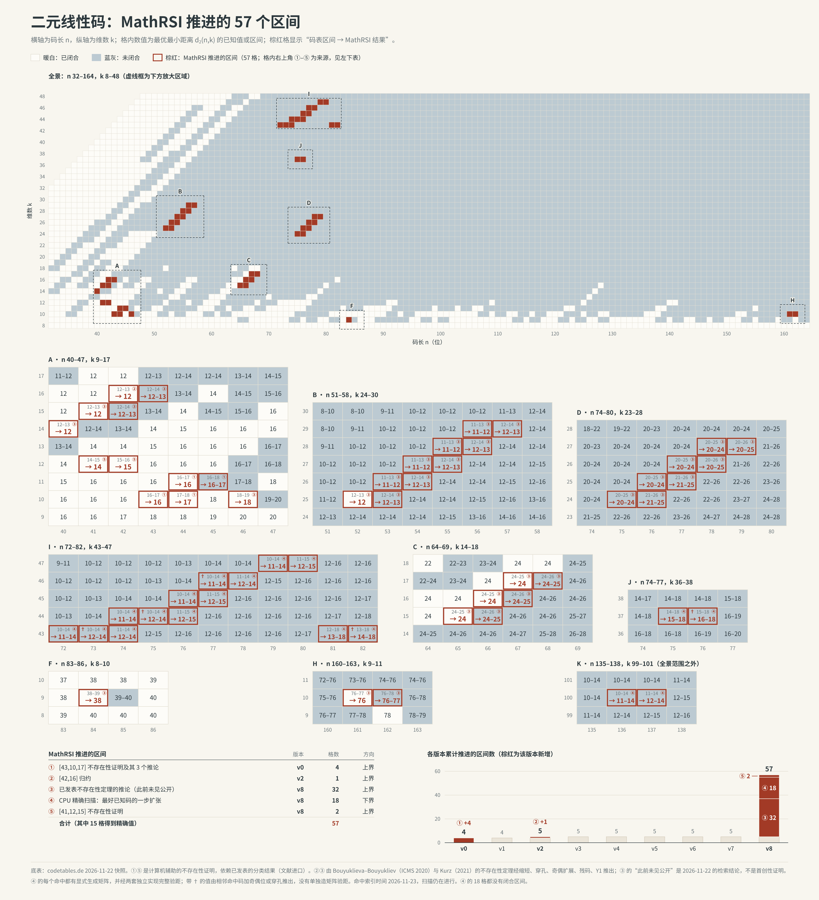

# 轨迹与配图：MathRSI 推进的 57 个二元线性码码表区间（2026-11-23）

**Trace and figures.** This directory holds the working trace (proofs, derivations, matrices, source code and verification records) behind 57 entries of the binary linear-code bounds table that MathRSI work has tightened, together with the summary figure that displays them. It is an evidence archive, not a release announcement: the caveats in “各组证据的性质与状态” below apply to every use of these numbers. `python3 check_package.py` replays the bookkeeping in a few seconds.

本目录由两部分组成：

- **轨迹**：`cells.csv`、`1-theorem-43-10/` 至 `5-theorem-41-12/`、`check_package.py`。图上每个棕红格在这里都有出处：`cells.csv` 一格一行，最后一列指向该格的证据文件。
- **配图**：`figures/`，中英两版的汇总图（PNG、PDF）。



[English figure (PNG)](figures/mathrsi-bounds-20261123-en.png) · [English PDF](figures/mathrsi-bounds-20261123-en.pdf) · [中文 PDF](figures/mathrsi-bounds-20261123-zh.pdf)

底表是 codetables.de 2026-11-22 的二元线性码界表快照（`3-corollaries-32/inputs/`）。图中的数字全部取自 `cells.csv`。

## 五组结果

| 记号 | 内容 | 格数 | 方向 | MathRSI 版本 | 目录 | 先读 |
|---|---|---:|---|---|---|---|
| ① | `[43,10,17]` 不存在性证明及其 3 个推论 | 4 | 上界 | v0 | `1-theorem-43-10/`（指向 `../source/`） | `../source/proofs/01-main-43-10.md`、`02-three-corollaries.md` |
| ② | `[42,16]` 归约 | 1 | 上界 | v2 | `2-reduction-42-16/` | `results/NONEXISTENCE_42_16_13_CANDIDATE.md` |
| ③ | 已发表不存在性定理的推论 | 32 | 上界 | v8 | `3-corollaries-32/` | `README.md`、`DERIVATIONS.md` |
| ④ | CPU 精确扫描：最好已知码的一步扩张 | 18 | 下界 | v8 | `4-scan-lower-bounds/` | `hits/INDEX.md`、`DERIVED_CELLS.md` |
| ⑤ | `[41,12,15]` 不存在性证明 | 2 | 上界 | v8 | `5-theorem-41-12/` | `HANDOFF.md`、`PROOF.tex` |

合计 57 格，其中 15 格得到精确值（①3 格、②1 格、③9 格、⑤2 格；逐格见 `cells.csv` 的 `exact` 列）。④ 的 18 格都没有闭合区间。

版本一列按项目负责人 2026-11-23 的说明填写。提交本目录时仓库的固定标签到 v7，v8 还没有对应标签。

## 各组证据的性质与状态

**① `[43,10,17]`**。计算机辅助证明：归约到 172 个满支撑偶 `[40,7,18]` 母码，对每个母码穷尽排除。依赖两条文献进口（不存在 `[41,8,18]`；母码至多 172 类）。证据已在本仓库的 [`../source/`](../source/README.md)，这里不再复制；范围说明见 [`../README.md`](../README.md)。

**② `[42,16]`**。归约到已发表的定理“不存在 `[41,14,14]`”（Bouyuklieva–Bouyukliev，ICMS 2020，命题 2），没有新的计算证明，不主张新颖性或优先权。正文文件名里的 `CANDIDATE` 是写作时的状态；审计记录在 `work/20261030-proof-audit/`。同一结论也是 ③ 的推导链中的一步（S7），仓库里另有整理稿 `../source/proofs/03-case-42-16.md`。

**③ 32 个推论**。全部由三条已发表的不存在性定理经缩短、穿孔、奇偶扩展、残码、Y1 推出，没有新的不存在性证明；另用到 54 条码表旧上界（未重证）。37 步推导可用 `verify.py` 重放。“此前未见公开”是 2026-11-22 的检索结论，不是首创性证明。该目录是 11 月 22 日打好的包，原样收入；其中的示意图是旧版，以 `figures/` 为准。

**④ 扫描下界**。对 Magma `BKLC` 给出的最好已知码，精确计算全部陪集的最小重量，足够深就能加一行（或加一行一列）把相邻格的下界提高 1。15 个命中格各有显式生成矩阵，并由两套独立实现做了完整验距（记录在各命中目录）。另有 5 个值（带 †）是由相邻命中码加奇偶位或穿孔推出的，**没有单独造矩阵验距**，见 `DERIVED_CELLS.md`。命中索引时间 2026-11-23T04:19:28Z；扫描当时仍在进行，之后的命中不在本目录内。

**⑤ `[41,12,15]`**。计算机辅助证明：对偶最小重量只能是 4、5、6，三个分支分别归约到 47、17,254、3,408 个母码，两套算法不同的实现逐码一致，解集全空。依赖两条文献进口（不存在 `[39,10,16]`；三类母码的类数）。正式审计（两轮）通过。**验收未走完**：该题规格要求的一项补充审阅因通道故障没有取得，题目状态尚未发布。详见 `HANDOFF.md`。

这些结果没有向码表维护者或其他外部渠道提交过。①⑤ 的结论都依赖文献进口；③ 的每一格还依赖码表旧上界。引用时请带上这些前提。

## 核对

在本目录下运行：

```
python3 check_package.py
```

只用 Python 标准库，几秒内跑完，最后一行输出 `RESULT: OK`。它重新计算的内容：

- `cells.csv` 的格数、分组、码表区间与快照一致，每格都是区间内的严格改进；
- ① 的三个推论的算术；①②⑤ 的下界矩阵全部码字枚举（共 8 个矩阵，① 的矩阵读自 `../source/data/lower-generators.json`）；
- ③ 的 37 步推导重放；
- ④ 的 18 格等于“已验收命中”在四条规则下的闭包；每个命中矩阵的形状与秩；已保存的验距记录为真；
- `SHA256SUMS` 所列全部文件的 SHA-256。

它**不**重新计算的内容：①⑤ 的不存在性计算本身，以及 ④ 中命中矩阵的完整验距（只读取已保存的记录）。这些要用各目录里的源码和说明另行重跑。

## 未收入的材料

| 材料 | 说明 |
|---|---|
| ① 的全部证据 | 已在 `../source/`，不重复入库。其中 172 个母码的完整 pair 拒绝流（约 1.7 GB）仓库只保留精简副本，见 `../README.md` |
| ⑤ 的逐码运行输出与小域对照数据 | 两套实现的 `run_*`、`validation`、`regression` 等目录（约 180 MB）与 w=6 五元和检查的逐码输出（86 MB）；全域逐码原始结果留在计算集群的共享盘上。本目录收的是源码、汇总与逐码比较结果 |
| ⑤ 的母码 2004 见证清单 | 17 MB；母码 1980 的已收，两者由同一脚本生成 |
| ⑤ 引用的已发表论文 PDF 与页面图像 | 第三方版权材料 |
| ⑤ 审阅的原始事件流与调用元数据 | 只收审阅的提示与答复 |
| ④ 中未命中的 1,700 余个基码的逐码结果、调度与运行记录 | 只收命中的证据；未命中的结果不支持图上任何一格 |
| 编译产物、集群任务记录、已被替换的第一版检查结果 | 源码已收。逐个清单见 `EXCLUDED.tsv` |

## 公开副本做过的处理

各子目录里的文档、源码和记录取自原工作区。入库前对文本文件做了一次统一的字符串替换，去掉与数学内容无关的内部标识：本机家目录的用户名、共享盘挂载前缀、两个集群任务号、模型调用通道的前缀、计算集群及其命令行工具的名称。除这些替换外内容没有改动；二进制文件（图、PDF、`.gz`）没有动。

- 被替换过的文件逐个列在 `REDACTIONS.tsv`，含替换次数、替换前后的 SHA-256。
- `SHA256SUMS` 是本目录现有文件的哈希。文档内部若记录了某个被替换文件的哈希，对应的是替换前的字节，可在 `REDACTIONS.tsv` 的 `sha256_original` 列查到。
- 文档中的相对路径以原题目录为根；本目录保留了原有的目录结构，但引用到未收入文件的路径在这里不存在。

## 第三方材料

见 [`THIRD_PARTY_NOTICES.md`](THIRD_PARTY_NOTICES.md)。
